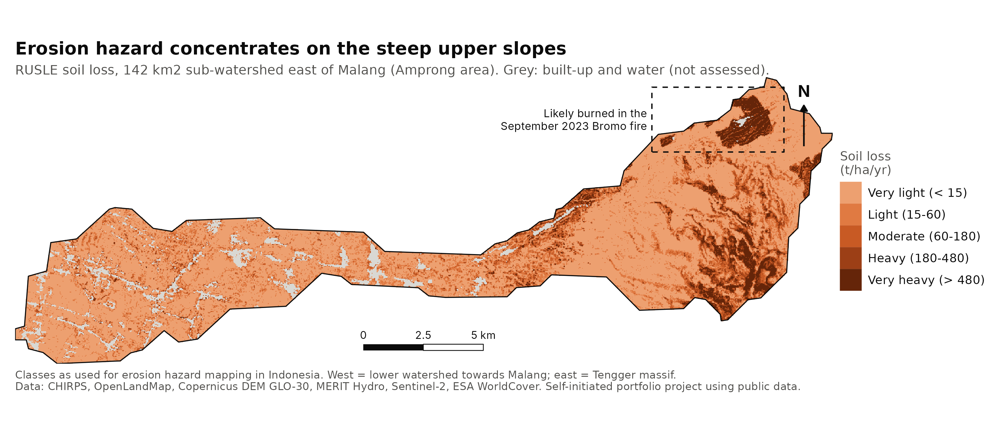
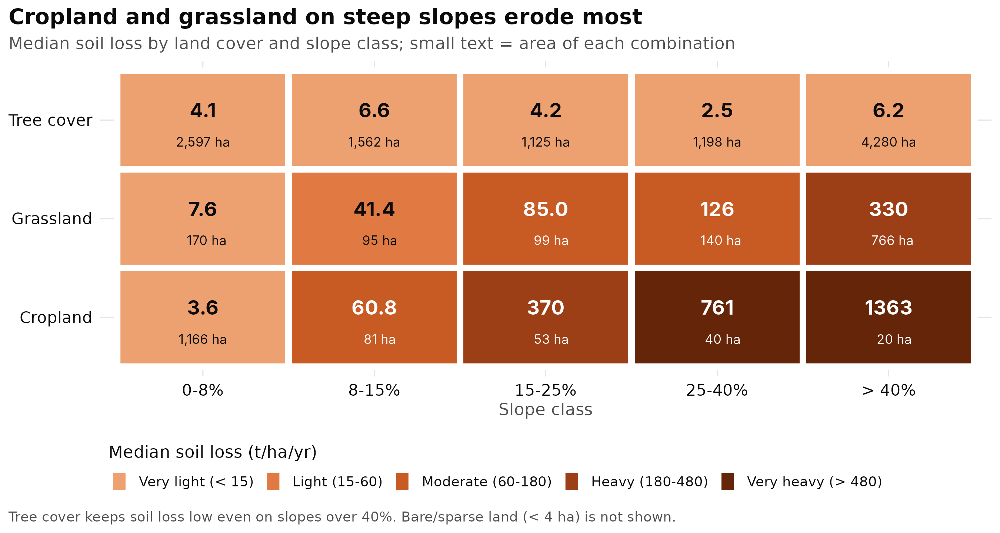
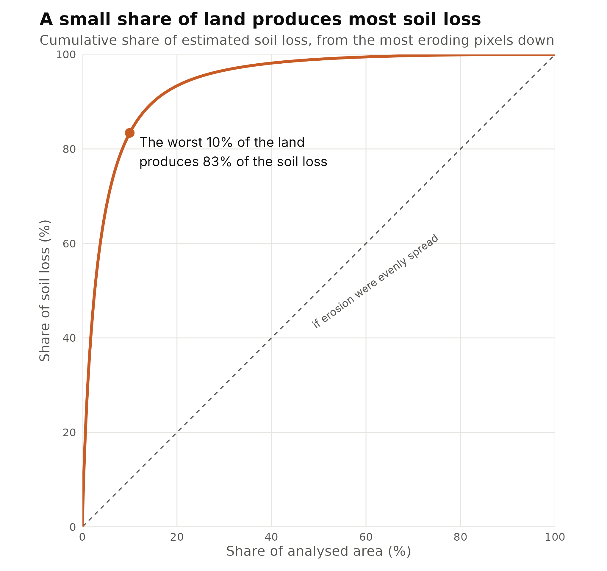
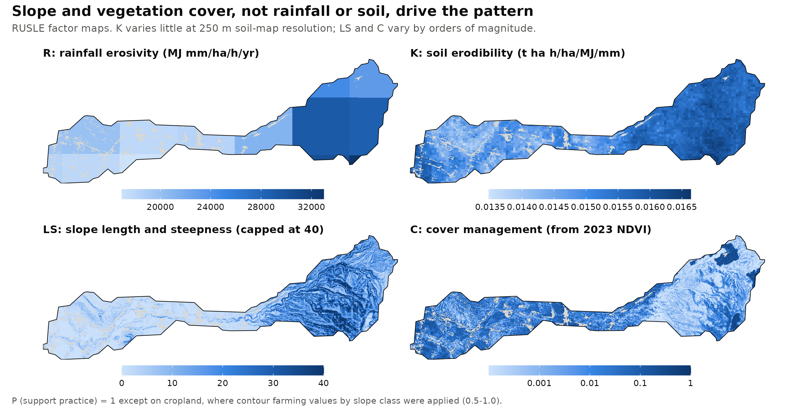

# Soil Erosion Risk with RUSLE in Google Earth Engine

*Self-initiated portfolio project using public data.*
Author: Utik Tri Wulan Cahya, PhD

Where is soil loss highest in an upland watershed, and which land is the priority for conservation? This project estimates annual soil loss with the **Revised Universal Soil Loss Equation (RUSLE)** in **Google Earth Engine**, then analyses the results in **R** by land cover and slope.

**Study area:** a 142 km² sub-watershed east of Malang, East Java (HydroBASINS level 9, ID 5090216470), likely within the Amprong sub-watershed of the upper Brantas basin. It runs from the lower valley near Malang up the western slopes of the Tengger massif.



## Method

A = R × K × LS × C × P (t ha⁻¹ yr⁻¹), calculated at 30 m.

| Factor | Data | Method |
|---|---|---|
| **R** rainfall erosivity | CHIRPS daily rainfall, mean 2014–2023 | Renard & Freimund (1994) |
| **K** soil erodibility | OpenLandMap topsoil sand, clay, organic carbon (250 m) | Williams (1995), EPIC equation |
| **LS** slope length and steepness | Copernicus DEM GLO-30; MERIT Hydro upstream area | Moore & Burch (1986); flow length capped at 300 m |
| **C** cover management | Sentinel-2 NDVI 2023, Cloud Score+ masked | Van der Knijff et al. (1999) |
| **P** support practice | ESA WorldCover 2021 cropland | Contour farming by slope class (Wischmeier & Smith 1978); 1 elsewhere |

Built-up land and water were excluded. Soil loss was grouped into the five erosion hazard classes used in Indonesia: < 15, 15–60, 60–180, 180–480 and > 480 t ha⁻¹ yr⁻¹.

In R, soil loss was summarised by land cover and slope class (0–8, 8–15, 15–25, 25–40, > 40%). No pixel-level significance tests were run: neighbouring 30 m pixels are spatially autocorrelated, so p-values would be misleadingly small.

## Key results

| Erosion class (t/ha/yr) | Area (ha) | Share |
|---|---|---|
| Very light (< 15) | 8,889 | 66.4% |
| Light (15–60) | 2,131 | 15.9% |
| Moderate (60–180) | 1,055 | 7.9% |
| Heavy (180–480) | 651 | 4.9% |
| Very heavy (> 480) | 670 | 5.0% |

- **Soil loss is highly concentrated.** The worst 10% of the land produces 83% of the estimated soil loss. The median is 5.7 t/ha/yr, while the mean is pulled up to 93 t/ha/yr by a small area of very steep, poorly covered land.
- **Grassland is the main source.** It covers 9.5% of the analysed area but produces 49% of the soil loss. Sixty percent of it lies on slopes over 40%, and its median soil loss is 166 t/ha/yr.
- **Tree cover protects even very steep slopes.** Median soil loss under tree cover stays below 7 t/ha/yr in every slope class, including slopes over 40%.
- **Most cropland is on gentle slopes** (86% on 0–8%) with a median of 4.4 t/ha/yr. The few cropland areas on slopes over 25% (60 ha) are among the most eroding land in the watershed (median 760–1,360 t/ha/yr).
- **Priority areas:** cropland and grassland on slopes over 25% with heavy or very heavy erosion cover 598 ha (4.5% of the area) and produce 48% of the estimated soil loss. Targeting this land with revegetation, terracing or agroforestry would address about half the problem on a twentieth of the area.
- **A recent fire scar inflates part of the estimate.** A 270 ha patch near the caldera rim had very low vegetation cover in 2023 (median C 0.25) and was likely burned in the September 2023 Bromo savanna fire. It produces 30% of the estimated soil loss. Because vegetation regrows after fire, this reflects a temporary post-fire peak, which is also when erosion control on burned slopes matters most.
- **The main conclusions hold without the fire patch:** the worst 10% of the land still produces 81% of the soil loss, grassland 53%, and priority areas (480 ha) 46%.







## Limitations

- RUSLE estimates **gross soil loss on hillslopes, not sediment delivered to rivers**. The values are best used to rank areas, not as measured erosion rates.
- RUSLE was developed for moderate slopes. Slopes over 100% cover 5.4% of the area but contribute 17.5% of the estimated soil loss; values there are likely overestimated.
- The R equation was derived outside the tropics, and CHIRPS has about 5 km resolution. K comes from a 250 m global soil map, so local differences in soil type are smoothed out.
- C is based on a single year, 2023, which was a dry El Niño year in East Java and the year of the Bromo fire. Lower vegetation cover that year raises C and soil loss; the burned patch was identified from the data and local knowledge, not from an official fire perimeter.
- ESA WorldCover "tree cover" can include orchards, agroforestry and mixed gardens as well as natural forest.
- The results were not validated with field measurements, and the HydroBASINS boundary is approximate.

## Files

| File | Content |
|---|---|
| `RUSLE_soil_erosion_GEE.js` | Earth Engine script: all factors, soil loss, classes, exports |
| `RUSLE_analysis.R` | R script: summaries, priority areas, figures |
| `RUSLE_layers.tif`, `RUSLE_area_by_class.csv`, `RUSLE_watershed.geojson` | Data exported from Earth Engine |
| `area_by_erosion_class.csv` | Area per erosion hazard class |
| `soil_loss_by_land_cover.csv`, `soil_loss_land_cover_x_slope.csv` | Soil loss by land cover and slope |
| `sensitivity_fire_patch.csv` | Key results with and without the likely 2023 fire patch |
| `soil_loss_concentration.csv`, `rusle_factor_summary.csv`, `land_cover_area.csv` | Supporting tables |
| `analysis_output.txt` | Full console output, including session info |
| `fig1`–`fig4` (`.png`) | Figures |
| `RUSLE_case_study.pdf` | Three-page case study |

## How to reproduce

1. Run `RUSLE_soil_erosion_GEE.js` in the Earth Engine Code Editor and export the three files.
2. Put them in the same folder as `RUSLE_analysis.R`, then run:

```r
install.packages(c("terra", "sf", "ggplot2", "patchwork"))
```
```
Rscript RUSLE_analysis.R
```

Results are written to a new `output/` folder. Analysed with R 4.3.3.

## Data credits

CHIRPS (Funk et al. 2015) · OpenLandMap soil layers (Hengl 2018, CC BY-SA 4.0) · Produced using Copernicus WorldDEM-30 © DLR e.V. 2010–2014 and © Airbus Defence and Space GmbH 2014–2018, provided under COPERNICUS by the European Union and ESA; all rights reserved · MERIT Hydro (Yamazaki et al. 2019) · Contains modified Copernicus Sentinel data (2023) · Cloud Score+ (Pasquarella et al. 2023) · ESA WorldCover 2021 (CC BY 4.0) · HydroSHEDS / HydroBASINS (Lehner & Grill 2013)
